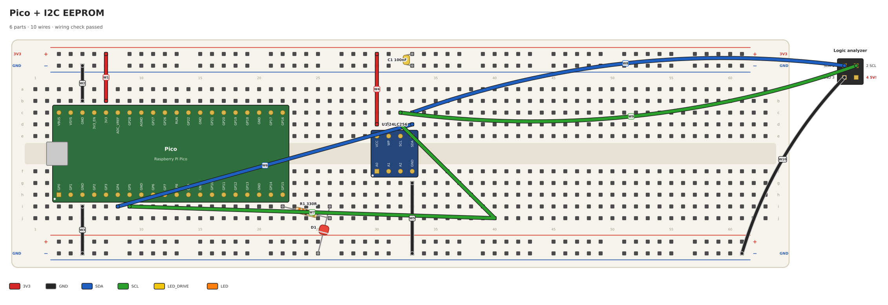

# bbgen

Breadboard layouts from YAML, written by you or by Claude Code. One circuit file gives you:

- **a drawing** (`.svg`, plus `.png` if ImageMagick or `rsvg-convert` is around): the board, every
  part with labelled pins, numbered wires coloured by net, and rings around anything that's wrong
- **a build checklist** (`.md`): parts first, then wires group by group, each with the holes it
  goes between and what it connects
- **a wiring check**: bbgen works out what the strips and wires actually connect and compares
  that with the nets you declared. Opens, shorts, stray connections, pins in the trench or under
  another part, and two things in one hole are all errors.



## Install

Needs Python 3.10+ and PyYAML. Either symlink the launcher onto your PATH:

```bash
ln -s ~/Documents/Code/bbgen/bin/bbgen ~/.local/bin/bbgen
```

or install it: `pip install -e .`

## Use

```bash
bbgen build circuit.yaml           # circuit.svg/.png/.md next to the YAML, and the check
bbgen build circuit.yaml --steps   # also one image per wire group, that group highlighted
bbgen check circuit.yaml           # the check only
```

The exit status is 0 when the check passes, 1 when it finds errors (the files are still written so
you can see them), and 2 when the file itself can't be read.

## The circuit file

This is [examples/eeprom.yaml](examples/eeprom.yaml):

```yaml
title: Pico + I2C EEPROM
notes: ["The LED's long leg is the anode."]   # copied into the checklist

boards:                       # optional; default is one full-size board
  - type: full                # full (63 columns) or half (30)
    rails: {top: "+-", bottom: "+-"}   # rail order top to bottom, as printed on yours
    split_rails: false        # true if your rails break in the middle

parts:
  Pico: {type: pico, at: h3}  # pin 1 in h3, USB to the left
  U1: {type: dip, pins: 8, width: 3, at: f30, title: 24LC256,
       labels: [A0, A1, A2, GND, SDA, SCL, WP, VCC]}
  R1: {type: resistor, value: 330R, pins: [Pico.GP15, j27]}
  D1: {type: led, pins: [R1.2, bot-]}
  C1: {type: capacitor, value: 100nF, pins: [top+33, top-33]}
  J1: {type: offboard, title: Logic analyzer, cols: 2, labels: {1: SDA, 2: SCL, 3: GND, 4: "5V!"}}

wires:                        # a list, or groups of lists (each group is a checklist section)
  power:
    - [Pico.3V3, top+]
    - [Pico.38, top-]
    - [Pico.3, bot-]
    - [U1.VCC, top+]
    - [U1.GND, bot-, black]   # optional colour; otherwise the net's colour
  i2c:
    - [Pico.GP16, U1.SDA]
    - [Pico.GP17, U1.SCL]
    - [U1.SDA, J1.SDA]
    - [U1.SCL, J1.SCL]
    - [bot-, J1.GND]

nets:                         # what should be connected; the check holds the board to this
  3V3: {pins: [Pico.3V3, U1.VCC, C1.1], color: red}
  GND: [Pico.GND, U1.GND, C1.2, D1.K, J1.GND]
  SDA: [Pico.GP16, U1.SDA, J1.SDA]
  SCL: [Pico.GP17, U1.SCL, J1.SCL]
  LED_DRIVE: [Pico.GP15, R1.1]
  LED: [R1.2, D1.A]
```

### Holes

- Terminal holes are `<row><column>`: rows `a`-`e` and `f`-`j`, columns from 1. Each column's
  a-e is one strip and its f-j another, with the trench between e and f (0.3 in apart).
- Rails are `top+`, `top-`, `bot+`, `bot-`, with a column: `top+12`. Rail holes come in groups
  of five, so some columns have none:

  | board | columns with rail holes | columns without |
  |---|---|---|
  | `full` (63 columns) | 3-7, 9-13, 15-19, 21-25, 27-31, 33-37, 39-43, 45-49, 51-55, 57-61 | 1, 2, 8, 14, 20, 26, 32, 38, 44, 50, 56, 62, 63 |
  | `half` (30 columns) | 2-6, 8-12, 14-18, 20-24, 26-30 | 1, 7, 13, 19, 25 |

  A pin that goes to a rail wants a column with rail holes, or its wire can't run straight.
- With several boards (placed left to right), prefix the board id: `2:a12`. Board ids default to
  1, 2, ...

### Wire ends and legs

A wire end or a two-lead part's leg is one of:

- a hole: `a12`, `top+30`
- a bare rail: `top+`, which takes the free rail hole nearest the other end
- a part pin: `U1.3`, `U1.VCC`, `Pico.GP15`. This takes a free hole in that pin's strip. A name
  shared by several pins is ambiguous unless they're joined on the part (`Pico.GND` is fine), or
- an off-board pin (`J1.SDA`). Wires only; legs go in holes.

A wire can bend on its way: `{from: U1.OUT, to: U1.IN-, via: [d43, g43]}` runs through those
holes in order. Bends are drawn and listed in the checklist; they don't take up the holes.

Pins that share a name without being joined on the part (five header pins all labelled `GND`) are
named by number instead: `J1.3`, `J1.6`.

bbgen picks the holes for both ends together. It prefers a pair that makes the wire (or the part)
run straight along a row or a column without lying along another wire or part, then the one over
the fewest part bodies, then the holes nearest the pins, then the shortest. Give rail columns
yourself when both ends are rails (`[top+28, top-28]` for a decoupling cap), since there's no other
end to steer by.

### Automatic wiring

With `autowire: true` at the top of the file, bbgen adds the wires itself: place the parts, list
the nets, and leave `wires` out (or write only the ones you want a say in; they're kept). Each net
is joined with the fewest, shortest wires it can find, preferring straight runs and rail drops
from the row next to the rail. A wire that would cross a part is bent around it, and each
off-board pin gets its own flying lead. The checklist lists them by net, rails' nets first.

Which rail a net runs on comes from, in order:

- the rails its parts already plug into (a decoupling cap with a leg in `top+28`)
- `rail:` on the net: `VSYS: {pins: [...], rail: top+}`, or a list, `rail: [top-, bot-]`
- a net named like ground (`GND`, ...) takes the `-` rails no other net uses, and one named like a
  supply (`VSYS`, `VBUS`, `5V`, ...) a free `+` rail

Anything that ends up slanted or crossing still gets its warning: then the fix is to move a part.

### Straight, not slanted

Wires and parts that slant are hard to trace and get in the way. bbgen warns (`DIAGONAL`) only
when one could have been straight, and says how:

- a hole written out where another hole in the same strip would line up (`bot+48 instead of bot+47`)
- a strip in a column the rails have no hole in, so it can't reach the rail straight (move the part)
- every straight route blocked by other wires or parts (it names them)

A wire crossing the trench between two different columns can't be straight, and flying leads to
off-board pins don't count. When a slant is the right call, say why, and the warning goes:
`slant: <reason>` on the part, or `{from: ..., to: ..., slant: <reason>}` for a wire. A wire with
`via` is routed by you and isn't checked.

### Off the parts

A wire or two-lead part lying over a part's body hides its pins and has to come out before the
part can. bbgen warns (`OVER_PART`), and for a wire suggests bends that take it around:
`via: [d43, g43]`. The checklist lists the bends with the wire. It also warns about a wire that
ends in a hole under a two-lead part's body (a resistor standing up to a rail covers the holes
between its legs), and one that runs along another wire or part, hiding it. Wires may cross.

### Where parts land

The rows are spaced like the holes, with the trench counting as two more: `a`-`e` are 1 apart,
and `e` to `f` is 3. So:

- **A DIP** (`width: 3`) straddles the trench only with pin 1 in row `f` (`rot: 0`) or row `e`
  (`rot: 180`). Anywhere else its two rows land in the same half, shorting each pair of
  opposite pins, or in the trench (`OFF_HOLES`). Unrotated, pins 1 to n/2 run right from pin 1
  and the rest come back along the row above, so the last pin sits above pin 1. `rot: 180`
  turns that around: pin 1 top-right, pins running left, notch to the right. `rot: 90` and
  `270` stand a part across the columns, which puts each row of pins in one strip.
- **A Pico** with pin 1 in `h<col>` has pins 1-20 in row `h`, running right from `<col>`, and
  pins 21-40 in row `c`, running back left, so pin 40 is above pin 1. Its body blocks rows `d`
  to `g`, which leaves each of its strips two free holes: `a` and `b` on top, `i` and `j` below.
  Only two wires can run along the rows from one side of the Pico over the same stretch, so
  spread its connections over both sides and both ends.

### Part types

| type | placed by | notes |
|---|---|---|
| `pico` | `at` (pin 1), `rot` | Raspberry Pi Pico, pins named GP0..GP28, GND, VSYS, 3V3, ... Unrotated: USB left, pins 1-20 along the bottom. Its GND pins are joined on the board; AGND isn't. Its body blocks rows d-g beneath it. |
| `dip` | `at` (pin 1), `rot` | `pins`, `width` (row spacing in 0.1 in, default 3), `labels`. Unrotated: pin 1 bottom-left, notch left. Use it for SMD-to-DIP adapters too. |
| `sip` | `at` (pin 1), `rot` | a single row: headers, trimmers |
| `resistor`, `capacitor`, `electrolytic`, `diode`, `led` | `pins: [leg1, leg2]` | `value`. Polarised legs are `+`/`-` and `A`/`K`, in that order. |
| `offboard` | drawn beside the board | `labels`, `cols`, `numbering: row` (1, 2 across the first row) or `column`, `place: right` or `below`. A label ending in `!` is drawn red. |

`rot` is 0, 90, 180 or 270, clockwise. `labels` is a list (one per pin) or a `{pin: name}` map.
Pins without a label are named by number. An off-board part has `pins` pins, or without that,
one per label (a list) or up to the highest pin in the map. Every part takes `title`, `value`
and `color`; a
resistor's `value` (`10k`, `4k7`, `330R`) is drawn as its colour bands. Two-lead parts also take
`slant` (see above).

### Colours

Wires, nets and parts take `red`, `black`, `blue`, `green`, `yellow`, `orange`, `white`, `purple`,
`gray`, `brown`, `pink`, `cyan`, or `#rrggbb`. A wire is its net's colour unless it says
otherwise. A net without a colour gets black if its name is a ground (`GND`, `VSS`, ...), red if
it's a supply (`VSYS`, `5V`, ...), and otherwise a colour no other net has, until they run out.

### What the check reports

| code | meaning |
|---|---|
| `OPEN` | a net is in more than one unconnected piece |
| `SHORT` | two nets are connected together |
| `STRAY` | a pin that's in no net is connected to something |
| `SHORTED_PART` | both legs of a two-lead part are in the same connection |
| `HOLE_TAKEN` | two things in one hole, or a hole under a part's body |
| `OFF_HOLES` | a pin lands in the trench or off the board |
| `NOT_PLACED`, `TWO_NETS`, `BAD_*` | a pin in a net isn't on the board; a pin in two nets; a reference that doesn't resolve |
| `BAD_RAIL` | a net's `rail:` isn't a rail, or names one another net already uses |
| `DANGLING` (warning) | a wire ends in a strip with nothing else in it |
| `NO_EFFECT` (warning) | both ends of a wire are in the same strip |
| `DIAGONAL` (warning) | a wire or two-lead part slants where it could run straight; the message says how |
| `OVER_PART` (warning) | a wire or two-lead part lies over a part's body (for a wire, the message gives bends around it), a wire ends under a two-lead part, or runs along another wire or part |

## With Claude Code

`skill/SKILL.md` teaches Claude Code the loop: write the YAML, build, fix every error, and look at
the PNG before handing it over. Link it in as a personal skill:

```bash
ln -s ~/Documents/Code/bbgen/skill ~/.claude/skills/breadboard
```

## Tests

```bash
python3 -m unittest discover -s tests -t .
```
