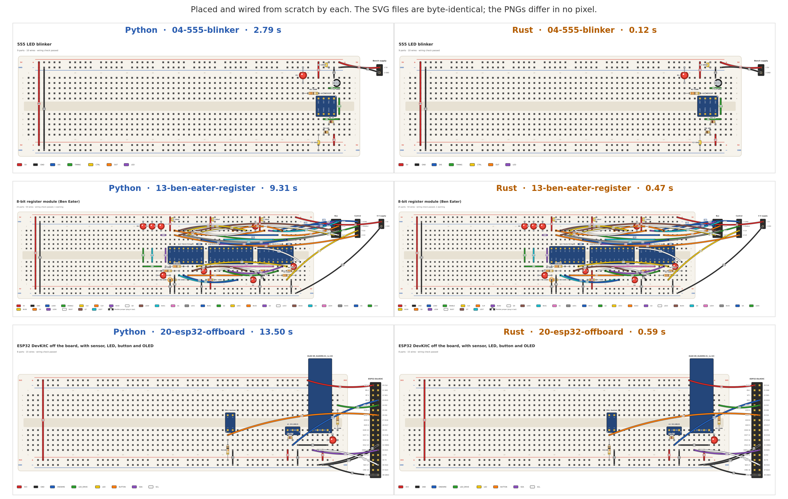

# Porting bbgen to Rust

**Done: bbgen is Rust now, and the Python is gone.** This page is how it got there. The scripts it
names (`hotspots.py`, `golden.py`, `rs_check.py`, `rs_trials.py`, `rs_outputs.py`) compared the two
versions; they went with the Python and are in git history, last in commit `5690f7b`. What
holds bbgen to the same results now is `cargo test` (see Phase 2.5–2.7 at the end).

A plan for deciding what to port, and for porting it so that it ends up faster and still produces the
same layouts. It's written for this codebase as of October 2026 (about 4,800 lines in `bbgen/`, 115
tests, 21 benchmarks).

## What the first profile says

Benchmark 13 (Ben Eater's register), one process (`BBGEN_JOBS=1`), cProfile: **68.5 s**, of which:

| where | cumulative | share |
|---|---|---|
| `_evaluate`: 159 full builds of a trial layout (Circuit + check) | 64.4 s | 94 % |
| … `autowire` | 45.7 s | 67 % |
| … … `_relay` (A* through empty strips) | 23.7 s | 35 % |
| … … `_reach` (where a straight wire from a hole can go) | 17.0 s | 25 % |
| … … `_rails` | 8.7 s | 13 % |
| … `place_legs` (two-lead parts) | 17.0 s | 25 % |
| `anneal` (the footprint estimate, 4 × 3000 steps) | 3.6 s | 5 % |
| SVG, checklist, YAML | ≈ 0 | |

Most of the time is spent in a large number of small operations:

- 24.5 M `round()` calls (4.2 s) and 11 M `_key()` calls (6.4 s): coordinates are rounded to make dict keys
- 8.3 M `Hole` objects created and 16 M `Hole.__hash__` calls (≈ 6 s): a frozen dataclass rebuilt in inner loops
- 9.5 M `Board.xy`, 3.6 M `_line`, 1.9 M `_crosses`, 13 M `min`, 13 M `max`, 21 M `abs` calls

About a quarter of the run goes to creating, hashing and rounding objects, and Rust doesn't have those
costs. The rest is the actual search logic, which typically runs 20–50× faster in Rust. With 8 workers,
13 takes 12 s, so the process pool already gives ≈ 5.7×.

The layouts don't depend on `PYTHONHASHSEED`: 04, 05, 06, 09, 10, 12 and 18 give the same layout hash
with seeds 0, 1 and 2. The only randomness is `random.Random(seed)` in `_Model.anneal`
(`shuffle`, `choice`, `random`).

## Split or whole port?

**Port the whole thing.** A small hot kernel worth splitting off doesn't exist. The hot path is "build a
circuit from the data, wire it and check it", and that covers almost the entire package:

| hot path (port for speed) | lines | | not hot (port for simplicity) | lines |
|---|---|---|---|---|
| circuit.py | 999 | | render.py | 612 |
| autoplace.py | 1183 | | kicad.py | 267 |
| autowire.py | 893 | | checklist.py | 132 |
| parts.py | 351 | | trace.py | 119 |
| check.py | 161 | | cli.py | 116 |
| board.py | 141 | | | |
| measure.py, costs.py | 171 | | | |
| **total** | **≈ 3,900** | | **total** | **≈ 1,250** |

A permanent split would put the language boundary at "data in, placed and wired circuit out". It would
also mean:

- the whole Circuit model mirrored on both sides, or serialised across the boundary
- maturin and a compiled wheel for every platform, where today it's `pip install` and nothing else
- two languages to work in, all to keep 1,250 lines of fairly simple code in Python

The things you'd want next also all favour a single Rust codebase:

- a Tauri desktop app, or the whole engine running in the browser as WASM
- one binary with no Python or PyYAML to install
- PNG through `resvg` instead of shelling out to ImageMagick

The Claude Code skill only calls the CLI, so it doesn't care what language is behind it.

**When a split would make sense instead:** if you want to keep experimenting with the heuristics in
Python for a long time (see `open-points.md`). Then port only `board`, `circuit`, `autowire` and
`check` behind a PyO3 module and keep the search driver in Python. That gets ≈ 70 % of the gain.

**Cost of porting while the heuristics still change.** Every later experiment happens in Rust. That's
slower to write, but a benchmark run that takes 5 s instead of 3.5 min makes experiments much faster to
judge. Land or shelve the `routing-improvements` work before starting, so you aren't porting a moving
target.

## Phase 0: measured (done)

Done on the `rust-port` branch with two new scripts, described in `benchmarks/README.md`:

- `benchmarks/hotspots.py` profiles every benchmark three ways (serial, serial under cProfile, and with
  the parallel search) and writes `benchmarks/hotspots.md` (now [python-hotspots.md](python-hotspots.md)).
- `benchmarks/golden.py` records the golden corpus (below) into `benchmarks/golden/` (276 KB). The
  recording hooks are in `bbgen/dump.py`.

The recording hooks don't change any layout:
- all 21 hashes match the untouched code's
- each placed file rebuilds to the same layout with the same wiring events
- the 115 tests pass

**Time per build, and how many builds.** A full trial build takes 12 ms (01) to 939 ms (16), and is
mostly between 60 and 230 ms. Placement makes 15 to 228 builds per circuit, about 3,000 in all.
Altogether that's 589 s serial and 221 s with the parallel search. (The serial runs shared the machine
eight at a time, so they're a little pessimistic.)

**Where it goes** (share of a circuit's serial time, across the 21 circuits):

| stage | share | notes |
|---|---|---|
| autowire | 7–73 % | `_relay` and `_reach` are most of it. Largest on 13, 14, 16, 17 |
| `place_legs` | 11–61 % | largest on 20 (off-board leads) and 15 |
| anneal | 4–78 % | most of the time on the small circuits (03, 19, 02); it never runs in parallel |
| object overhead | 7–18 % | `round`/`_key`, and building and hashing `Hole`s |

Across all circuits, 30 % of the time is spent in Python's built-in functions.

**The finished drawing isn't free.** Check, drawing and checklist take 1.1 s on 16, 218 ms on 13 and
117 ms on 14. That matters for a UI that redraws after every edit, and is another reason to port
`render` rather than keep it in Python.

**The parallel search gets 2.7× out of 8 cores** (1.3× to 4.2× per circuit). Three causes:
- **Cancelling never works.** `future.cancel()` can't stop a trial a process pool has already queued,
  so every trial in a batch is built: 3,979 builds started for 2,985 used, a third more work than
  needed.
- **The kept circuit is built again.** A worker sends back only a score, so the main process builds
  every kept trial a second time, one at a time: 2 to 38 builds per circuit.
- **Anneal runs alone**, and each batch waits for its slowest build.

Threads sharing memory in Rust remove the second cause outright. Builds that are 20–50× cheaper
shrink the others.

**Go.** At a cautious 20× per build, 16 drops from 75 s to about 9 s on one core and a few seconds on
eight. 13 would take about 11 ms per build. That clears all three bars: 16 in under 5 s with threads,
re-routing in a UI in well under 100 ms, and room for a 10× longer search.

**The KiCad library matters.** 20 of the 21 circuits read their parts from the KiCad library installed
here (Flatpak, KiCad 10.0.6; `golden/index.json` records the path). So:
- the Phase 1 spike has to port `kicad.py` too, which is 267 lines of s-expression reading
- a different library version may change the golden layouts, so record the corpus again (and say so)
  when updating KiCad

## Phase 1: a spike that decides the rest (≈ 1 week)

Port only what's needed to **wire a layout that's already placed**:

- `board`, `parts`, `costs`, `kicad`
- the parts of `circuit` that load an already-placed file
- `autowire`, `check`

The inputs are ready: `benchmarks/golden/placed/*.yaml`, the 21 benchmarks exactly as placement left
them. Each one's record ends with the build of that file: its parts, rails, every wire's cost and
holes, and the check. Then compare:

- **parity:** the wire list hash matches Python's for every benchmark
- **speed:** time to build and wire one layout, Rust against Python

If parity holds and the speed-up is ≥ 20×, port the rest. If it's much less, the time is going into
search steps rather than interpreter overhead. In that case, fix the algorithm (incremental scoring,
caching `_reach` and the blocked steps between trials) in whichever language you're in.

### Phase 1 results: parity on all 21, 20× faster (done)

The port is in `rust/`, about 5,600 lines: `board`, `kicad`, `parts`, `circuit`, `autowire`, `check`,
`measure` and the parts of `autoplace` a placed build uses (`lead_room`, the score). It doesn't place
anything yet; it turns away a file that still needs placing. `python3 benchmarks/rs_check.py` builds it,
checks every placed benchmark against the golden record, and times it (`--python` times Python too).

**Parity.** All 21 placed benchmarks give the same events as Python, one for one, on 16 that's 395 of
them. That covers:
- every pin's hole
- the rails each net owns and the order nets are wired in
- every wire's cost key, the wire laid, and every wire taken out, put back or swapped
- every check message, the score to the last bit, and the layout hash

The diff catches a 1e-9 change in a single cost. The float helpers (`round`, `math.dist`, `hypot`,
`sum`, `repr`) match Python bit for bit on 500,000 random cases.

**Speed, with Python timed in the same run.** One placed build (load, wire, check, score) is 13× to 30×
faster per circuit, and 20× over all 21: 998 ms against 51 ms. 16 takes 391 ms in Python and 21 ms in
Rust, 13 takes 91 ms and 4.9 ms. The faithful translation alone gave 10×. Four changes, none of which
alters a result, took it to 20×:
- **Candidate pairs as indices.** They were full copies, and stable-sorting about 10,000 of them per
  round moved megabytes.
- **foldhash instead of SipHash, then instead of FxHash.** Positions as keys have mostly zero low bits,
  and FxHash piled them into the same buckets.
- **Cheaper `math.dist`.** Dekker's split instead of a software FMA, powers of two built from bits, and
  an exact shortcut along rows and columns (checked against Python on 2 million cases).
- **Pairs sorted lazily** from a heap. Both loops stop early, so most pairs are never sorted.

**What's left on the table** (none of it done yet, all of it guarded by the same check):
- Owner names are still strings (`"W12"`, `"the body of U1"`).
- `unwire` recomputes every wire's covered holes.
- `empty_strips` rescans the board after every wire.
- Many small `Vec`s are allocated for lists Python builds (`between`, `strip_holes`, `bodies_crossed`).

Allocation still costs about 15% of the time. The small circuits gain least (about 15×), since their
builds are mostly this kind of overhead. These are in [open-points.md](open-points.md), point 11.

**Verdict: go on to Phase 2.** The faithful port matches exactly, and the 20× bar is met by the build
alone. What's left to port (placement's search) is the same kind of code. The parallel search should
gain more on top, since threads remove the rebuilds and the pickling.

## Phase 2: the rest, in order

### Phase 2.1 results: the search, the same as Python, 28× faster (done)

The port places parts too:
- the estimate model and annealing, with CPython's Mersenne Twister and its two-element set order copied
  exactly (checked against Python)
- leg placement for two-lead parts
- the start, turn, repair and polish search

`python3 benchmarks/rs_check.py --full` runs each benchmark from its own file and compares the whole
record, from the model's choices and every anneal result to every trial, every kept move and every wire.
It runs once on one core and once on all cores, and checks the layout hash both times.
`benchmarks/rs_trials.py` rebuilds each of the 2,985 recorded trials in Rust; all of them score the same.

**Parity: all 21 the same,** on one core and on all cores.

| | Python | Rust |
|---|---|---|
| all 21, one core | 589 s | 17.0 s (35×) |
| all 21, all cores | 221 s | 8.0 s (28×) |
| 16, all cores | 75 s | 2.8 s |
| 13, all cores | 11.3 s | 0.47 s |

Trials are built on threads (`rayon`), the next few side by side, and taken in order, so the search stops
where it would on one core. A worker's circuit comes back with its score, so no trial is built twice. On
one core the time for 16 splits into wiring (56 %), leg placement (30 %) and the estimate (10 %).

**Found on the way:**
- **A bug in the Python.** In `_settle_leads`, `x not in leads` compares wires by value. A lead laid
  again exactly as it was, under the same number, is taken for the old one, which is then put back beside
  it: a `HOLE_TAKEN` error in 35 of the ~3,000 trials. The port copies it to keep the layouts the same.
  Fix it on both sides at once, and record the corpus again.
- **YAML is read as PyYAML reads it.** The Rust reader uses libyaml's grammar and PyYAML's SafeLoader
  rules for plain scalars (`rail: -}`, `yes`/`on`, octal `010`, `1_000`). On all 47 YAML files in the
  repository, plus a file of awkward cases, it gives exactly what `yaml.safe_load` gives.
- **Python's annealing calls `math.exp`.** Rust's `f64::exp` calls the same libm on Linux, so the results
  match here. On another platform, check the golden records before trusting a match.

Each step ships with its parity check before the next one starts.

1. **Search** (`autoplace`): the `_Model` estimate, `anneal`, `place_legs`, `_repair`, `_polish`,
   `_turned`. Parallelise with `rayon`, still accepting trials in order, so the result stays exactly the
   same for any number of threads, as it is now with processes. Threads also remove the `fork`
   requirement, which isn't available on Windows.
2. **Outputs**: `render` (SVG as plain string building, PNG via `resvg`), `checklist` and `measure`.
   SVG and Markdown should come out byte-identical, which is easy to diff.
3. **`kicad`** (s-expression parsing) and **`trace`**. Recording becomes a callback the builder calls,
   and the frames are still encoded by ffmpeg.
4. **CLI** with `clap`: same subcommands, flags, file names and exit codes (0 / 1 / 2). Run
   `tests/test_cli.py` against the binary.
5. **Benchmarks**: `benchmarks/run.py` can stay Python and just call the binary. Reset `baseline.json`
   only if the numbers changed on purpose.
6. **Tests**: port the 115 tests into Rust integration tests, keeping the YAML fixtures. Most of them are
   "this YAML gives these holes or issues", so they translate directly.
7. Remove the Python package, and update the README and the skill's install instructions.

Suggested layout: a cargo workspace with `bbgen-core` (library, no I/O beyond parsing), `bbgen-cli`
(binary) and, later, `bbgen-wasm` / a Tauri app on top of the same core.

### Phase 2.2–2.4 results: outputs, video and command line (done)

`bbgen-rs build/check/find` does what `bbgen` does: the same SVG (and step drawings), checklist,
printed report and exit status, the same `find` results, and the same video (`--video`,
`--video-all`). `benchmarks/rs_outputs.py` builds files with both and compares everything written.
All 138 come out byte for byte the same: the 21 placed benchmarks, the 4 examples, and the 113
circuits the unit tests build (`benchmarks/golden/cases/`, many of them deliberately broken). The
video's frames match byte for byte too, every try included.

A second Python bug is copied for now: the adapter-pin error's second half isn't an f-string, so it
prints `{{{pad}: {n}}}` as it stands.

**Not done at this stage, since then:**
- **The benchmarks' measures:** done in 2.5–2.7 (`bbgen dev measure`).
- **Removing the Python:** done in 2.5–2.7.
- **The unit tests:** replaced by the golden records and expected outputs in `cargo test` (2.5–2.7).
- **PNG without ImageMagick, and fixing the two Python bugs:** still open, with the rest of what's
  left, in [open-points.md](open-points.md), point 11.

## How to keep the layouts identical

**Port faithfully first, optimise second.** Get the hashes to match with a near-literal translation, then
make it faster with the hash as the guard (the same rule `open-points.md` already sets for a speed-up).
Data-layout changes that can't change results are fine from day one.

**Compare stage by stage, not just the end result.** A single final hash only tells you *that* the two
diverged. `bbgen/dump.py` records each build as JSON events, one per line:

- the `_Model` choices, and the best layouts from each anneal seed with their costs
- every trial layout built, with its score, and which ones were kept (start, turn, repair, polish)
- the file as placed, then the final build's parts, the rails each net owns and the order nets are
  wired in
- each wire's cost key as it's chosen, the wire with its holes and detour, and every wire taken out,
  put back or swapped
- the check's issues and the layout's score

The Rust port writes the same events in the same format. Then `python3 benchmarks/golden.py --diff`
names the first event where the two differ. Floats are written as Python's `repr`, so they compare
exactly.

**Floating-point and library details that will break exact parity unless handled:**

- `round(x, 3)` rounds correctly to decimal, with ties to even. Rust's `f64::round` rounds ties away
  from zero, so don't use it for `_key`. Better: store every position as integer thousandths once, at
  construction, and the problem goes away.
- From Python 3.12, `sum()` of floats uses compensated (Neumaier) summation. Rust's `.sum()` is a plain
  sum. Write a matching `fsum`-style helper and use it wherever Python calls `sum` on floats.
- `math.dist` / `math.hypot` can differ from Rust's `hypot` in the last bit. Check the costs where it's
  used, since ties between equal-cost options decide many choices.
- `min`, `max` and `sorted` keep the *first* of equal items, and `sorted` is stable. Use Rust's stable
  `sort_by` and write `min_by` loops that keep the first minimum.
- Dicts keep insertion order. Use `IndexMap` wherever Python iterates over a dict, and never iterate a
  `HashMap` where order can affect the result.
- `random.Random(seed)` is MT19937 seeded by `init_by_array`. `choice` and `shuffle` use `_randbelow`
  (rejection over `getrandbits(k)`), and `random()` builds 53 bits from two 32-bit outputs. Copy these
  exactly with the `rand_mt` crate plus about 40 lines of your own. The alternative is to replace the RNG
  in Python first with something trivial to port (SplitMix64), re-baseline, then port.
- YAML: `serde_yaml` is archived, so use a maintained fork. Check that key order and how numbers and
  `+`/`-` strings are read match PyYAML on every fixture.

If one benchmark can't be made identical without unreasonable effort, accept it when every quality
metric in `results.md` is equal or better, and write down why.

## Where the speed comes from (after parity)

In rough order of payoff, judging by the profile:

1. **No re-parsing per trial.** Today every trial builds a `Circuit` from the data dict. Split it into an
   immutable `Problem` (boards, part library, nets), shared via `Arc`, and a small per-trial `State`
   that's cheap to clone.
2. **Holes as indices.** A full board is about 900 holes. A `Hole` becomes a `u16`, coordinates are
   integers, and `occupied`, `_used`, `_lain`, `_covered` and `_ends` become bitsets or `Vec<bool>`.
   That removes the 24 M rounds, 16 M hashes and 8 M allocations outright.
3. **Precomputed geometry.** `Board.xy`, strips, `levels`, and which steps a body blocks (`_step_blocked`)
   are worked out once per placement instead of looked up through dicts.
4. **`_relay` and `_reach`** (60 % of autowire): a binary heap over integer strip ids, reusable scratch
   buffers, and no list of `Hole`s rebuilt per call.
5. **Threads instead of processes**: no pickling and no fork. A smaller speculative batch wastes fewer
   builds.
6. Then the algorithmic ideas from `open-points.md` and above (incremental re-wiring when a move only
   touches one part), now cheap enough to try.

**Targets to hold the port to:** a full build of 13 in under 20 ms (Python ≈ 400 ms), 16 in under 5 s
end to end, all 21 benchmarks in under 30 s. The time saved can also buy better layouts: more anneal
steps, a larger `REPAIR_BUILDS`, or rip-up-and-reroute that was too slow in Python.

## Effort, roughly

| phase | size |
|---|---|
| 0: profile all, golden corpus and dumps | 1 day |
| 1: spike (board, circuit, autowire, check) | 1 week |
| 2.1: search | 1 week |
| 2.2–2.4: outputs, KiCad, trace, CLI | 1 week |
| 2.5–2.7: tests, docs, Python removed | a few days |
| optimisation behind the hash | open-ended; the big wins are in the first days |

Most of the time goes into tracking down parity mismatches, not writing Rust. That's why the stage dumps
come before any Rust is written.

## Phase 2.5–2.7 results: the Python removed (done)

- **Layout.** The crate lives at the repository's root (`Cargo.toml`, `src/`), and the binary is `bbgen`.
  `bin/bbgen` is a shell launcher that builds it when the sources change, so a symlink to it on the
  PATH keeps working. `cargo install --path .` installs it instead.
- **The tests replace the comparisons with the Python.**
  - `tests/golden.rs` holds all 21 benchmarks to their recorded events.
  - `tests/trials.rs` rebuilds all 2,985 recorded trials and requires the same scores.
  - `tests/outputs.rs` holds `bbgen build`'s report, exit status, checklist and drawing (as SHA-256) to
    what the Python gave for 138 files. Those expected outputs (`benchmarks/golden/expected/`) were
    taken from the Python just before it was removed.

  A deliberate one-weight change (`FLEX_COST` 10 → 10.5) makes them fail, as it should.
  `benchmarks/record.py` records new behaviour once a change is meant.
- **The benchmarks run on the binary.** `bbgen dev measure` gives what `benchmarks/run.py` tabulates.
  All 21 benchmarks match the baseline the Python saved in every one of the 17 measured fields; only the
  time changed (8.4 s against 215 s). `run.py` needs nothing but Python's standard library now.
- **Documentation.** The module docs carry the explanations the Python docstrings had, and
  `src/costs.rs` keeps every weight's comment.
- **Kept as the Python did it, to keep the layouts:** the two bugs above (a re-laid lead equal to the
  old one, and the adapter-pin message), Python's float rounding, CPython's random numbers and set
  order, and PyYAML's reading of files. Fixing the bugs moves wires: record the corpus again when you
  do.
